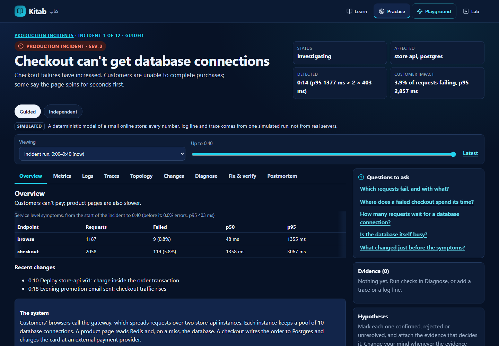
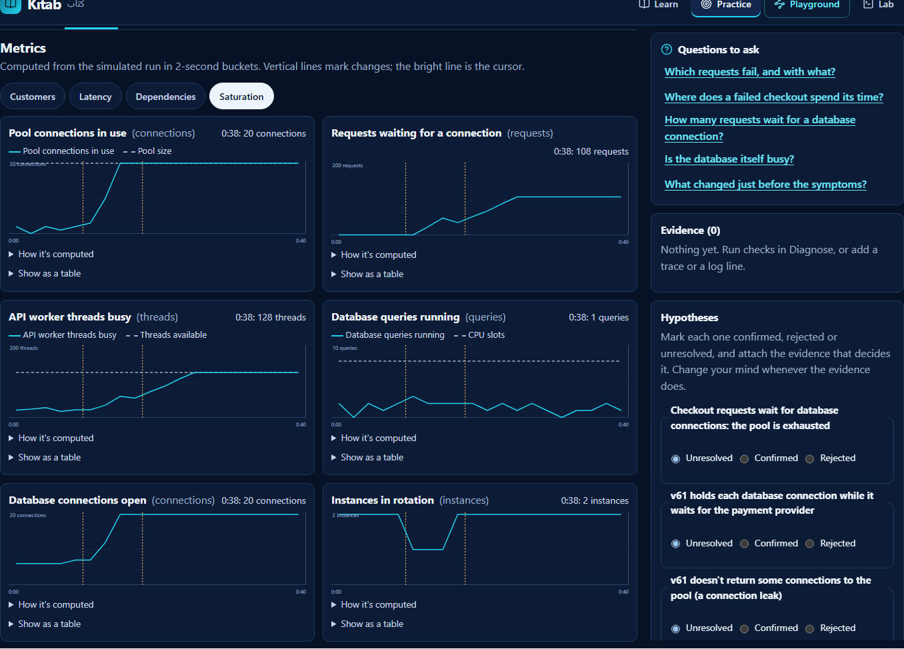
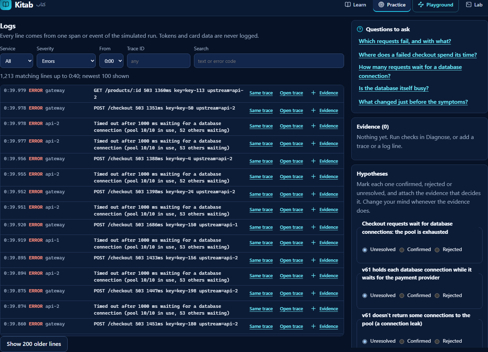
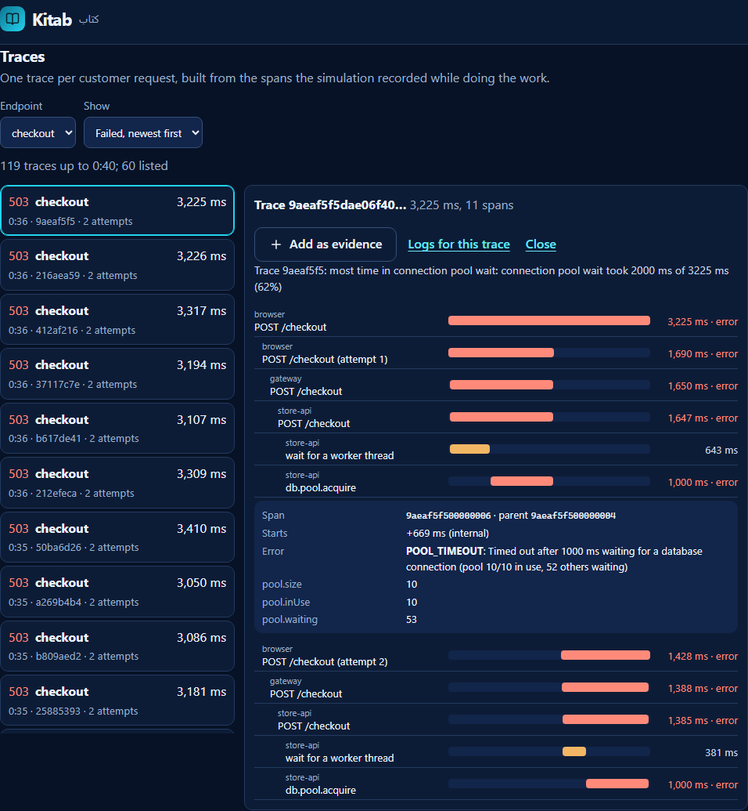
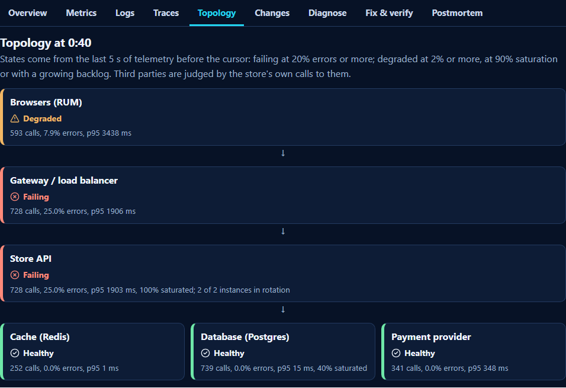
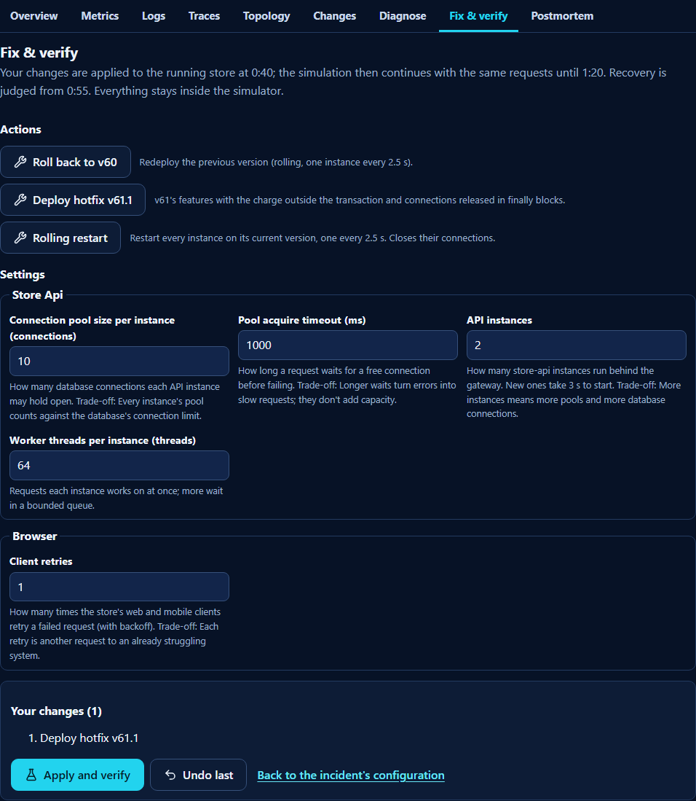
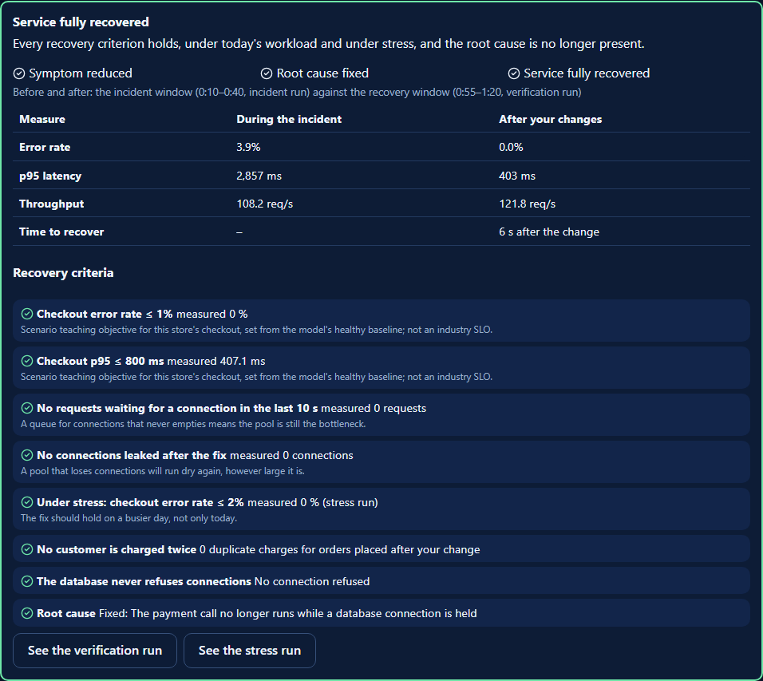
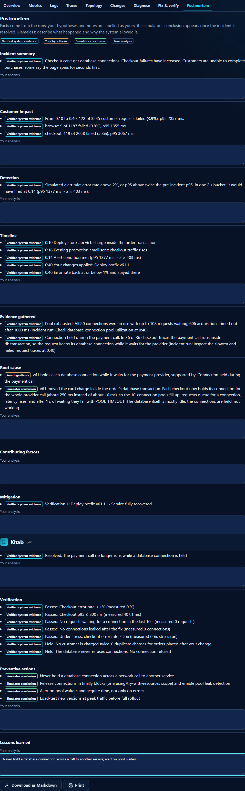
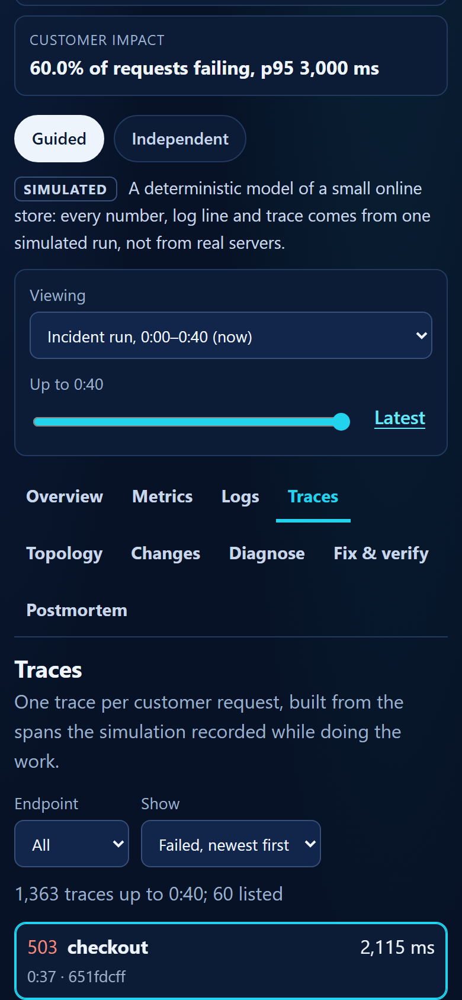

# Production Incident Simulator

`/practice/incidents` lists twelve incidents in one simulated online store. Each incident opens a command centre
(`/practice/incidents/:id`). The learner investigates with metrics, logs, traces, topology, a change timeline and
diagnostic checks, records hypotheses with evidence, changes the system, verifies the recovery (today's workload and a
stress workload), and writes a postmortem.

Everything a learner sees comes from **one deterministic simulation run**. No chart, log line, trace or verdict is
generated separately, and no AI decides anything.

## Files

| File | What it holds |
|---|---|
| `src/incidents/engine.ts` | The discrete-event model of the store, and `simulate()` producing one run (events and spans) |
| `src/incidents/telemetry.ts` | Everything derived from a run: request facts, metric buckets, logs, traces and waterfalls, topology health, diagnostics and their findings |
| `src/incidents/scenarios.ts` | The known-good store (`DEFAULT_STATE`) and the twelve scenarios, as typed data |
| `src/incidents/assess.ts` | Remediation steps, incident and continued runs, verification outcome, assessment rubric, postmortem |
| `src/incidents/progress.ts` | `kitab.incidents.v1` through `keyed-store` |
| `src/incidents/sim.worker.ts`, `ui/useSim.ts` | The dedicated simulation worker and its client |
| `src/incidents/ui/` | `IncidentsPage`, `IncidentPage` (command centre, notebook, fix and verify, postmortem), `views.tsx`, `incidents.css` |
| `tests/incidents.test.ts`, `e2e/incidents.spec.ts` | Unit and browser tests |
| `scripts/incident-perf.ts` | `npm run incident-perf`: timings and sizes per scenario |

## Architecture and reuse decisions

- **New orchestration layer, reused primitives.** The engine uses the Architecture simulator's event `Heap`
  (`src/architecture/simulate.ts`) and the identity track's deny-by-default policy (`authz.evaluate`, for the 403
  decision). Its token checks follow `src/identity/jwt.ts` `validate` in the same order: algorithm allowlist, kid in
  the JWKS, signature, issuer, audience, expiry.
- **Not reused: the Architecture Playground's `simulate()`.** It has no connection pools, DNS, token validation,
  deployments, rate limits or circuit breakers. Adding them would have changed a validated engine that every
  Architecture lesson, challenge and test depends on. The incident engine is a separate model of one fixed store. It
  does not claim that the Playgrounds and the simulator observe one shared runtime.
- **The topology is fixed.** It is browser or partner app → (DNS) → gateway with load balancing and rate limits →
  store-api instances → Redis, Postgres, the payment provider and the orders queue → fulfilment worker → fraud
  service. The identity provider and the Finance app serve the sign-in flows. Each scenario enables only the parts it
  uses (`features`).

## The engine

`simulate({ seed, state, changes, builds, features, endMs })` is deterministic and bounded: 120,000 events, 260,000
spans, at most 120 simulated seconds, and at most 400 arrivals per second per stream.

- **State.** `Config` holds what the store's engineers control. `Env` holds what they don't: traffic, the payment
  provider, the identity provider, broken hardware. Changes are scheduled patches (dot paths, type-checked by
  `applyPatch`) plus operations: rolling restart, replacing broken instances, reloading keys.
- **Builds.** A deployment changes `api.version` to a build whose behaviour is data. Examples: the payment call
  inside the transaction, a leak on the declined-card path, a crash on discount codes, a customer query with no
  index. Changing the version triggers a rolling restart: each instance drains, restarts, and rejoins every 2.5 s.
- **Requests.** Arrivals are seeded Poisson per stream. A request's traits come from a hash of the seed and its id:
  client, CDN edge, resolver, discount code, product, user. The same request therefore has the same id and trace ID
  in every run with that seed, whatever the configuration.
- **What is modelled:**
  - client timeouts and retries with backoff;
  - DNS resolver groups that cache answers for their TTL;
  - token-bucket rate limits keyed by API key or by the address the gateway sees;
  - round-robin load balancing with liveness or readiness checks;
  - per-instance worker threads with a bounded queue;
  - per-instance connection pools with lazy connects, FIFO waiters, an acquire timeout, and leak accounting;
  - Postgres with CPU slots, a FIFO run queue, a declared contention factor (+25% per extra slot's worth of queued
    queries, capped at 3×), the database's connection limit, and an index that takes 8 s of one slot to build;
  - cache-aside Redis with per-product TTLs, optional per-instance request coalescing, and price changes for the
    sale product;
  - the payment provider: capacity, FIFO queue, load shedding above 400 queued calls, idempotency keys, and work it
    finishes after the caller stopped waiting;
  - per-instance circuit breakers (half of the last 20 calls, at least 10; open 5 s; one trial call);
  - the orders queue and fulfilment workers, with the fraud service, poison messages and a dead-letter queue;
  - OIDC sign-in for the Finance app (sessions, registered redirect URIs).
- **Spans** are opened when modelled work starts and closed when it ends, so a trace can only contain work that
  happened. A synchronous child never ends after its parent, unless the parent's caller gave up: then the span carries
  `callerGaveUp`, as real traces show orphaned work. Asynchronous work (the worker) is linked by `followsFrom`. Work
  still running at the end of a run is marked `unfinished`, never given an invented end.
- **Gauges** are periodic readings of model state every 500 ms (threads, pools, database, queue, provider, breaker,
  resolvers). Metrics that report saturation read them.

## Telemetry: how each view is computed

- **Request facts:** completed legitimate logical requests in a window. A failure is no answer, 5xx, 429 or 401
  after the client's retries. A 402 (card declined) and a 403 (missing scope) are correct answers. Scraper and attack
  traffic is excluded. Percentiles are nearest-rank, so p95 is always one of the simulated latencies.
- **Metrics:** 2-second buckets over the run. Each metric's definition is shown beside its chart (`METRICS` in
  `telemetry.ts`). Saturation metrics are the maximum gauge reading in the bucket. Every chart has a table view.

  
- **Logs:** one line per gateway span (access log), one per span where an error started (not repeated on its
  ancestors), and one per state event (deployments, health changes, breakers, leaks, dead letters, duplicate charges,
  JWKS loads). Lines can be filtered by service, severity, time, trace ID and text. Spans and events never hold
  tokens, passwords or card data, so no log line can.

  
- **Traces:** one per customer request, shown as a waterfall with service, duration, error and attributes per span.
  A trace or a log line can be added as evidence.

  
- **Topology:** each component's health at the cursor, from the 5 s of telemetry before it. Failing means 20% errors
  or more. Degraded means 2% or more, 90% saturation, or a growing backlog. Third parties are judged by the store's
  calls to them. DNS shows "No telemetry", because the store runs no DNS servers.

  
- **Diagnostics** (`DIAGNOSTICS`): sixteen checks, each answering one question from the viewed run and window. Their
  **findings** (`pool.exhausted`, `db.ok`, `auth.unknown-kid`, …) are facts with the numbers that triggered them, and
  normal findings are produced as well as abnormal ones. Evidence is a set of findings. Hypotheses name the findings
  that support or refute them.

## Scenarios

Each scenario (`Scenario` in `scenarios.ts`) defines:
- an id, version, title, difficulty and severity;
- the incident report and the customer impact;
- its components, endpoints and features;
- builds and the baseline over the known-good store;
- timing: fault 0:10, fix 0:40, end 1:20 or 1:40, plus a settle time;
- variants, each with its changes, root-cause rules, key evidence and conclusion;
- the stress workload;
- controls (typed, bounded; validated by the lab kernel's `validValue`) and actions;
- recovery criteria (labelled as this scenario's teaching objectives, not industry SLOs) and safety invariants;
- hypotheses with support and refute findings, guided questions, a hint ladder and the architecture explanation;
- glossary terms, learning links, prevention and limitations.

| # | Incident | Root cause in the model | A valid fix | What doesn't fix it |
|---|---|---|---|---|
| 1 | Database connection pool exhaustion (2 versions) | v61 holds a connection across the payment call, or leaks connections on the declined path | Hotfix v61.1, or roll back | A bigger pool (mitigates; fails stress; 30 per instance exceeds the database limit), restarts, more instances |
| 2 | Cache stampede | The sale product's 8 s TTL without coalescing: every expiry sends dozens of misses to Postgres | Request coalescing | A 60 s TTL (breaks the ≤ 10 s freshness requirement); a bigger database (mitigation) |
| 3 | Retry storm | 3 immediate retries keep the provider's queue full after its slowdown ended | ≤ 2 retries with backoff and jitter plus idempotency keys, or a circuit breaker | Doing nothing; more instances |
| 4 | Unhealthy instance | The gateway routes by liveness, so a full-disk instance keeps a third of traffic | Readiness routing (and replace the instance) | Replacing it alone (fails when a second instance breaks) |
| 5 | DNS misconfiguration | The A record typed as 203.0.113.100 | Correct the record; recovery takes one cached TTL | Client retries; lowering the TTL afterwards |
| 6 | API authentication (3 versions) | A JWKS loaded only at startup after a key rotation; a wrong audience; an issuer change | Refetch the JWKS on an unknown kid; restore the audience; trust the new issuer | Turning signature checks off, allowing HS256, skipping the audience check (all unsafe); reloading keys once (fails at the next rotation) |
| 7 | SSO outage | The Finance app's new redirect URI isn't registered at the IdP | Register it exactly (or send the old one) | A wildcard redirect URI, longer sessions (both break policy) |
| 8 | Queue backlog | Worker w18 adds a 400 ms fraud call, and poison messages retry forever | ≥ 16 workers (within the fraud service's capacity) and a dead-letter queue | Rollback alone (poison stays); 12 workers |
| 9 | Failed deployment | v43 crashes on discount codes | Roll back or deploy v43.1 | More instances, restarts |
| 10 | Query regression | v52's customer query scans 2 million rows | Add the index (8 s to build) or roll back | A bigger database (fails at twice the traffic) |
| 11 | Rate limiting | Plugin 4.0 keys limits by client IP, which behind the CDN is one of four edges | Key by API key | Raising the limit or turning it off (lets the scraper through) |
| 12 | Multi-factor (advanced) | v44's SDK: 10 s timeout and 3 immediate retries, meeting a provider slowdown, exhaust every API thread | Timeout ≤ 3 s, bounded retries, idempotency keys, a breaker | A breaker alone (slow calls never trip it); rollback alone (client retries charge twice); more threads (worse) |

Reproducible walkthroughs: `tests/incidents.test.ts` (`PLANS`) runs each fix and each non-fix. `npm run
incident-perf` prints every run's size and timing.

## Remediation, verification and outcomes

- A remediation is a list of steps: a declared control set to an in-range value, or a declared action. `stepError`
  rejects anything else. Steps fold into one change, applied to the **running** store at the fix time. The
  simulation then continues with the same requests. Undo removes the last step; "Back to the incident's
  configuration" clears them. Every verification is kept in the attempt's history.
- `verify` runs two continued executions: today's workload, and the scenario's stress workload (more traffic,
  another slowdown, a second failure, another key rotation). It then evaluates:
  - **Recovery criteria**, measured in the recovery window or a criterion's own window.
  - **Safety and security invariants**, from the fix time on: no duplicate charges for orders placed after the
    change, no forged or other-API token accepted, no unsafe validation settings, no database connection refusals,
    prices fresh within 10 s, no wildcard redirect URIs, sessions within policy, the scraper still limited.
  - **The root-cause rules** of the variant, read from the resulting configuration and builds.
- Outcomes, in priority order:
  - Not safe;
  - Service fully recovered;
  - Root cause fixed, not yet robust;
  - Mitigated, root cause still present;
  - Root cause fixed, service not recovered yet;
  - Worse than before;
  - Symptom reduced (30% better on the error rate, p95 or any criterion);
  - No improvement.

  The time to recover is also shown: the first moment after which every 2 s bucket stays at or below 1% errors.

## Modes, hints and assessment

- **Guided:** the system explained, glossary terms, questions to ask (each ticked when its check runs), and
  progressive disclosure in Metrics (two charts per group until "Show more"). **Independent:** none of that.
  **Advanced** (incident 12) has two root causes and no guided questions.
- **Hints:** four per incident. The last one names the cause and a fix. Hints are counted, and using all of them
  marks the completion as assisted.
- **Assessment** (`assess`), from the attempt and its verifications only:
  1. symptoms identified (abnormal findings collected);
  2. evidence for the cause (the variant's key findings);
  3. a defensible root cause (every root hypothesis confirmed with attached supporting evidence, and no
     contradicted hypothesis confirmed);
  4. safety (no verified change set that made things worse or broke an invariant);
  5. recovery (the last verification fully recovered);
  6. verification quality (verified after the last change, stress included).

  **Completed** means 3 and 5 are met and the final change was verified. Any remediation that meets the criteria is
  accepted. The page says what the rubric can't measure: judgement.

## Postmortem

Twelve sections: summary, impact, detection, timeline, evidence, root cause, contributing factors, mitigation,
resolution, verification, prevention, lessons. Every entry is labelled:
- **Verified system evidence:** from the runs. Detection uses a simulated alert rule: error rate above 2%, or p95 above
  twice the pre-incident p95.
- **Your hypothesis.**
- **Your analysis:** notes, at most 2,000 characters per section.
- **Simulator conclusion:** shown only once the incident is resolved.

The postmortem never claims an investigation that didn't happen. It exports as Markdown (a Blob download) or
prints (print styles hide the controls).

## Simulated versus actual

Every incident page carries a **SIMULATED** label. Learning links marked **Lab** open the Real Engineering Lab, labelled
**ACTUAL**, where real code or real HTTP runs:
- retries and timeouts (`/lab/architecture/retries-timeouts`);
- caching (`/lab/architecture/caching`) and capacity (`/lab/architecture/capacity`);
- troubleshooting (`/lab/architecture/troubleshooting`);
- DNS over HTTPS (`/lab/networking/dns-resolver`) and status codes with Retry-After (`/lab/networking/headers-status`);
- JWKS verification (`/lab/identity/jwks-verify`), the audience bug (`/lab/identity/audience-bug`), exact redirect URIs
  (`/lab/identity/redirect-uri`) and real 401 versus 403 (`/lab/identity/protected-api`).

These are existing labs. No new lab, endpoint, network access or sandbox change was added, so the Lab's isolation is
unchanged.

## Persistence

`kitab.incidents.v1` (keyed-store, one record per incident) stores:
- the version;
- the number of attempts;
- the current attempt: variant, mode, steps, evidence, hypotheses, hints, diagnostics run, verification summaries and
  notes;
- up to 30 finished attempts;
- the completion time.

Every field is bounded by zod. Runs are never stored: they are recomputed from the seed and the steps. On load, the
last verification is recomputed in the worker.

Opening an incident saves nothing. The first action starts an attempt. Only `finish` (called when `assess` says
complete) writes completion. Reset clears the attempt and keeps the completion.

A damaged or newer-format record is kept untouched, a newer store version is never written, and blocked storage
shows a notice instead of failing. Two tabs changing the same incident end with the last save, as in every Kitab
store. Other stores are unchanged.

## Performance

Measured on the development machine (Windows, Node 22) with `npm run incident-perf`:
- An incident run takes 19–292 ms.
- A verification (two continued runs) takes 72–1,120 ms.
- The largest scenario records about 221,000 spans over its three runs.

All of this runs in the dedicated module worker, so the page stays responsive. The worker is created per page and
terminated when the page unmounts. Without Worker support, the same functions run after a tick.

| Bundle (production build) | Size |
|---|---|
| Entry `index-*.js`, before → after | 475.72 → 476.71 kB (146.95 → 147.20 kB gzip): routes only |
| `IncidentsPage` (lazy) | 2.89 kB |
| `IncidentPage` (lazy) | 58.69 kB (17.61 kB gzip) |
| `incidents` engine, scenarios and telemetry (lazy) | 152.81 kB (47.51 kB gzip) |
| `sim.worker` (loaded by the incident page) | 218.62 kB |
| Shared `glossary` chunk (lazy) | 17.44 → 27.82 kB |

UI bounds: logs show the newest 100 matching lines (200 more per click); traces list 60; charts have at most 60
points; evidence holds 40 items, steps 30, verifications 20.

## Accessibility and responsive layout

- The workspace is one tablist: arrow keys, Home and End move between tabs, and only the selected tab is in the tab
  order.
- Charts are `role="img"` with a text summary, plus a table view.
- Health and outcomes use icons and words as well as colour.
- Announcements use a polite live region. Hypotheses are fieldsets with radios.
- Under 1,100 px the notebook stacks below the workspace; under 760 px traces, logs and spans stack.
- Tests check every tab for horizontal overflow at 1440, 1024, 768, 390 and 320 px. They also pass at 390 px in the
  official Linux Playwright image (`mcr.microsoft.com/playwright:v1.64.1-noble`).
- Reduced motion turns off smooth scrolling; nothing animates.

## Security

- No server endpoint, network request, credential or new execution path was added. The worker imports only the
  engine and the scenarios.
- Remediation input is restricted to declared controls and actions with bounded values. Stored data is parsed and
  bounded.
- Tokens in the model are facts about claims, never JWTs, and logs carry only claim values (kid, iss, aud).
- Weakening authentication, allowing algorithm confusion, wildcard redirects, longer sessions, disabled rate limits
  and duplicate charges are all detected as broken invariants. None can count as a recovery.

## Testing

- `npm test` includes `tests/incidents.test.ts`:
  - engine determinism, ordering, bounds and stable identities;
  - span nesting and duration invariants for every scenario;
  - resource limits;
  - pool, leak, retry, cache and token rules;
  - percentiles and metric sums;
  - log provenance and trace correlation;
  - topology;
  - scenario completeness and links (with anchors);
  - key evidence produced by every run;
  - every fix and non-fix;
  - unsafe shortcuts;
  - step validation, assessment and postmortem sources;
  - persistence (bounds, damaged and newer data, blocked storage);
  - routes.
- `npx playwright test e2e/incidents.spec.ts` covers:
  - the guided database journey through to the postmortem, download and reload;
  - the independent retry storm;
  - the identity journey, with an unsafe change refused;
  - the multi-factor incident;
  - layout and keyboard at every width;
  - replay and the not-found page.
- `npm run incident-perf` gives the timings above.

## Known limitations

- All durations are modelled numbers with seeded variation, not measurements of Postgres, Redis, a payment provider,
  DNS or a network. No TCP handshake or packet is simulated. A connection to an address nothing answers on simply
  waits until the client gives up.
- Time is compressed to fit 80–100 s runs: tokens live 30 s, sessions 40 s, TTLs seconds.
- One fixed store. Health checks are never slow. Coalescing is per instance. Row locks, replication, autoscaling and
  a real bulkhead are not modelled.
- Requests still in flight at the end of a run have no completion and aren't counted.
- The rubric checks observable steps; it can't measure engineering judgement.
- Cross-tab edits to the same incident: the last save wins.
