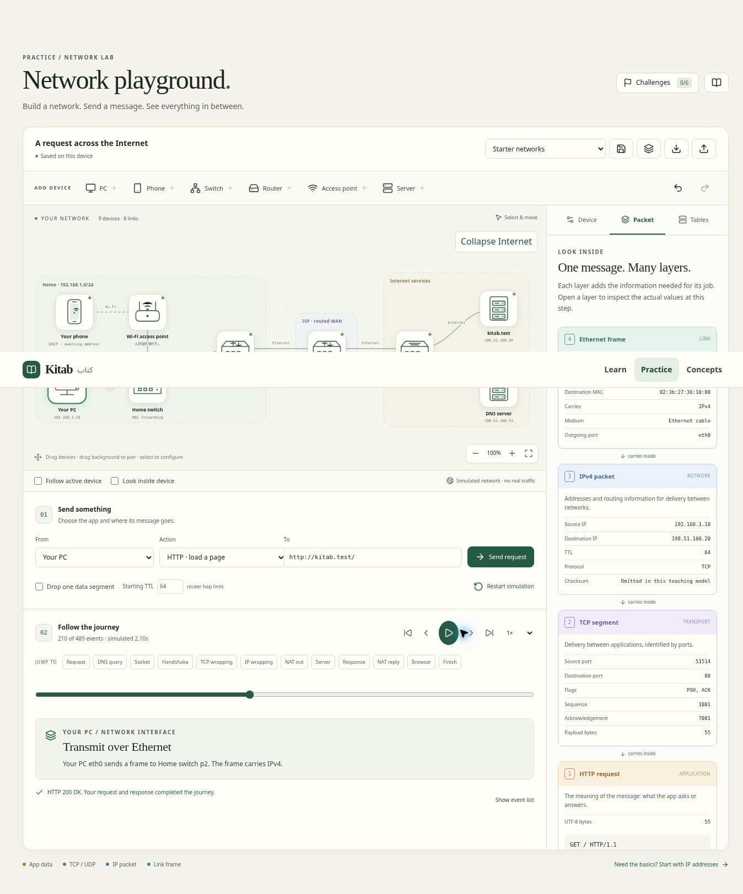

# Network playground verification

## Delivered behavior

Practice → Network playground opens `/practice/network`. The sandbox includes five starters, editable devices and interfaces, Ethernet/Wi-Fi connections, IP configuration, DHCP, DNS, routes and NAT. Six guided challenges use the same simulator. Immutable snapshots drive packet wrapping, state tables, device close-ups and backward/forward replay. Save/load, JSON import/export, autosave and undo/redo retain designs locally.

## Validation on 2026-11-08

- `npm run build`: 165 tests passed, 0 failed; app, worker and E2E TypeScript checks passed; production Vite build passed.
- `git diff --check`: clean. No changes under `public/`, preserving the existing standalone Packet Journey.
- Manual desktop browser checks: all six guided challenges completed; HTTP response and rewind; failed gateway explanation; add/undo/redo; named saves; reload persistence; Internet expansion; export/import round trip; nested HTTP/TCP/IPv4/Ethernet fields.
- Regression checks: adding a routed interface and switching devices no longer crashes. Moving a device and undoing preserves its DHCP lease and replay; a subsequent HTTP request succeeds.
- Playwright tests are authored, but local Chromium cannot launch because the environment denies its socket operation. Automated E2E and mobile screenshot checks are pending; manual checks are not represented as an automated pass.

## Review fixes

A fresh whole-branch review identified six issues. Fixes cover safe unsaved interface rendering, DHCP renewal in a full pool, lease expiry during transfers, DNS source selection on multihomed devices, visible unknown-unicast flooding and learned-port enforcement, and preserving runtime state when undoing layout-only changes. Protocol fixes have regression tests; UI regressions have browser tests and manual checks.

## Teaching boundaries

This is an educational IPv4 simulator, not a real network emulator. No packets leave the browser. TCP uses fixed 96-byte segments and a simplified send/acknowledgement loop. TLS, radio physics, checksums, VLAN/STP, congestion control and dynamic routing are not modeled. Event time is a deterministic teaching clock, not measured network latency. Lease expiry requests a new DHCP action instead of modeling automatic T1/T2 renewal. Bridge topologies are loop-free. These limits are surfaced in the workspace.

