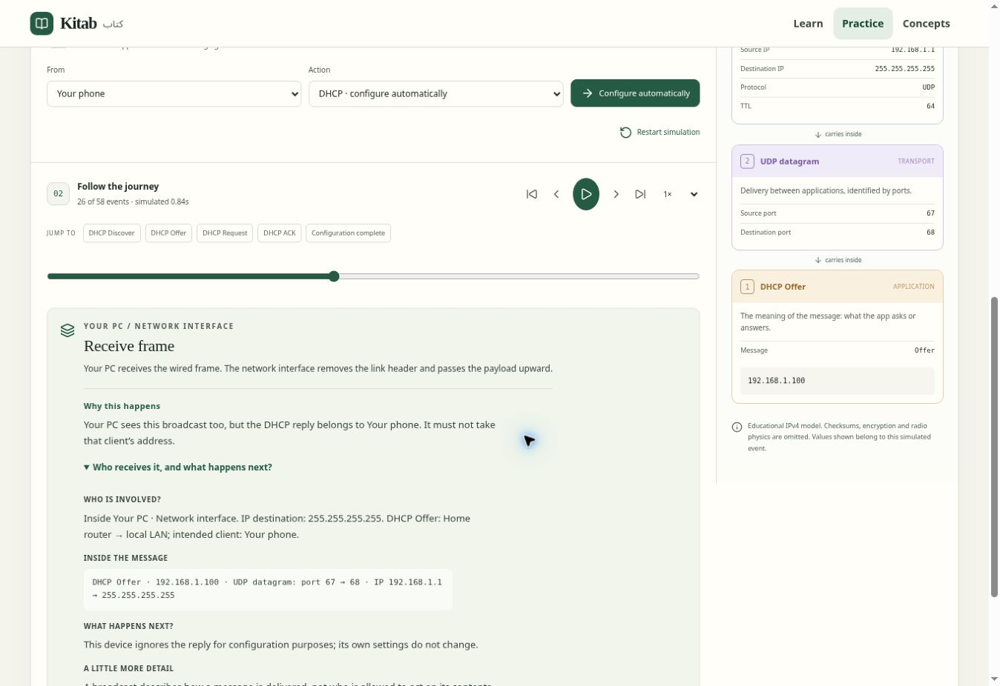

# Explanations beside simulation events

## Experience

Each selected event has a short “Why this happens” explanation inside its existing card. “Who receives it, and what happens next?” expands the participants, current packet fields, immediate consequence and further context. Opening details pauses playback. Details stay expanded when stepping; explanations follow the selected snapshot when rewinding.

DHCP distinguishes the original client/server exchange from local forwarding. A switch explains forwarding; the chosen DHCP server explains its service role; the requesting client explains accepting an offer or confirmation; unrelated endpoints explain why they hear a broadcast without answering or taking the offered address. Four DHCP milestones and configuration completion have direct shortcuts. Broadcast forwarding has its own event label rather than being called unknown unicast.

The same treatment covers ARP, DNS, sockets, TCP handshake, buffering, encapsulation, routing, TTL, NAT, HTTP request/response, ICMP, Wi-Fi association and failure states. Explanations describe the particular operation rather than repeating one definition per protocol.

## Implementation

`explanations.ts` reads the selected event and network. DHCP client/server IDs are teaching context on the event, separate from the transmitted packet fields. This preserves client identity even when two devices share a display name. No runtime network state is changed by reading explanations. `StepExplanation.tsx` renders semantic details/summary, retaining keyboard access and narrow-screen wrapping.

## Verification

- `npm run build`: 172 unit tests, app/worker/E2E type checks and production build pass.
- New coverage: DHCP broadcast recipients, client/server/bridge roles, duplicate display names, separate server, error precedence, immutable event reads, operation-specific HTTP explanations and broadcast labels.
- Manual desktop browser verification: DHCP Discover/Offer and other-PC reception; details pause playback, remain open when stepping, and show the correct message ports and participants. HTTP response and rewind update the explanation. No horizontal page overflow at the tested desktop viewport.
- A Playwright regression covers pause and DHCP recipient text across the configured screen sizes. It is authored and typechecked, not executed locally: the existing Chromium socket restriction prevents local Playwright launch. Mobile screenshot checks remain pending.

## Protocol grounding and model boundaries

Cross-checked DHCP initial discovery/selection and broadcast versus unicast replies with [RFC 2131 §3.1 and §4.1](https://www.rfc-editor.org/rfc/rfc2131.html); TCP sequencing and acknowledgement semantics with [RFC 9293 §3.4](https://www.rfc-editor.org/rfc/rfc9293.html). The text explicitly distinguishes this simulation's choices: one selected DHCP server, broadcast server replies, repeated initial exchanges for renewal, simplified TCP and no DHCP relays. The explanations do not expand the underlying simulator into a full protocol implementation.

